# ssm长诗圣地美食交流分享平台

> 🎓 **计算机毕业设计 · ssm长诗圣地美食交流分享平台**
>
> 本仓库只放**项目介绍 + 运行截图**（截图是站点带水印的原图，存在仓库 `images/` 里）。
>
> 👉 **完整可运行源码 / 数据库脚本 / 部署文档：[点我获取](https://geekcode.top/archives/ssm%E9%95%BF%E8%AF%97%E5%9C%A3%E5%9C%B0%E7%BE%8E%E9%A3%9F%E4%BA%A4%E6%B5%81%E5%88%86%E4%BA%AB%E5%B9%B3%E5%8F%B0?utm_source=github)**
>
> 💬 咨询微信：**ir9372**　|　🌐 更多项目：[极客代码 geekcode.top](https://geekcode.top/?utm_source=github)
>
> 📌 项目详情页：<https://geekcode.top/archives/ssm%E9%95%BF%E8%AF%97%E5%9C%A3%E5%9C%B0%E7%BE%8E%E9%A3%9F%E4%BA%A4%E6%B5%81%E5%88%86%E4%BA%AB%E5%B9%B3%E5%8F%B0?utm_source=github>

<table><td width="230" align="center"> <b>扫码加微信 ir9372</b></td><td valign="middle">📦 源码 = 项目介绍 + 全部运行截图 + 数据库 + 部署文档 👉 点上方任意截图，直接跳到 <b>极客代码 geekcode.top</b> 详情页</td></table>

---

<h1>ssm长诗圣地美食交流分享平台</h1>
<h2>项目概述</h2>

本项目名为“ssm长诗圣地美食交流分享平台”，旨在构建一个基于 Web 的美食资讯与社区交互系统。项目核心功能涵盖用户注册登录、美食店铺展示、社区美食推荐、留言反馈、评论互动、收藏记录管理及新闻通知发布等模块。适用人群主要为美食爱好者及普通互联网用户，通过该平台获取美食信息并进行社交互动。技术架构上，项目采用经典的 SSM（Spring + Spring MVC + MyBatis）框架结合 JSP 前端页面进行开发，实现了前后端逻辑分离与传统服务端渲染的结合，具备成熟稳定、易于维护的特点。

<h2>技术架构</h2>

<strong>后端架构</strong>：
项目严格遵循 SSM 框架标准分层架构：

<ol>
<li><strong>表现层 (Web Layer)</strong>：使用 Spring MVC 处理 HTTP 请求，控制器负责接收参数并调用业务逻辑，视图解析器返回 JSP 页面。</li>
<li><strong>业务逻辑层 (Service Layer)</strong>：由 Spring 管理 Bean 的生命周期和事务控制，封装核心业务规则。</li>
<li><strong>数据访问层 (DAO Layer)</strong>：使用 MyBatis 作为 ORM 框架，通过 XML 映射文件或注解实现 Java 对象与数据库记录的转换，简化 SQL 操作。</li>
</ol>

<strong>前端架构</strong>：
采用 JSP (JavaServer Pages) 技术生成动态网页。页面中嵌入 EL 表达式和 JSTL 标签库以展示后端传递的数据模型，结合 HTML/CSS/JavaScript 实现界面布局与基本交互。

<strong>数据库设计要点</strong>：
虽然未提供具体 DDL，但根据功能模块推断，数据库需包含用户表 (<code>allusers</code>, <code>yonghuzhuce</code>)、美食店铺表 (<code>meishidianpu</code>)、社区美食表 (<code>shequmeishi</code>)、评论表 (<code>pinglun</code>)、留言表 (<code>liuyanban</code>)、收藏记录表 (<code>shoucangjilu</code>) 及新闻通知表 (<code>xinwentongzhi</code>) 等实体关系，主要键值关联包括用户 ID 与各业务表的关联外键。

<strong>核心技术选型理由</strong>：
SSM 组合是 Java EE 领域的经典轻量级框架，具有配置灵活、生态成熟、文档丰富等优势；JSP 适合快速构建传统管理型或内容展示型网站，无需复杂的构建工具链即可部署运行。

<h2>功能模块</h2>

根据截图列表及项目名称分析，系统主要包含以下功能模块：

<strong>用户端功能</strong>：

<ol>
<li><strong>用户认证模块</strong>：</li>
</ol>
<ul>
<li><strong>用户注册</strong>：新用户提供基本信息完成账号创建 (<code>yonghuzhuce</code>)。</li>
<li><strong>用户登录</strong>：已注册用户通过身份验证进入系统 (<code>login</code>)。</li>
</ul>
<ol start="2">
<li><strong>内容浏览模块</strong>：</li>
</ol>
<ul>
<li><strong>美食店铺展示</strong>：查看各类美食店铺的详细信息列表 (<code>meishidianpu</code>)。</li>
<li><strong>社区美食分享</strong>：浏览其他用户推荐的美食内容 (<code>shequmeishi</code>)。</li>
<li><strong>大出拉啦/DCLL 专区</strong>：特定主题或分类的内容列表 (<code>dachulaila</code>, <code>dcll</code>)。</li>
<li><strong>新闻通知</strong>：查看平台发布的最新公告或资讯 (<code>xinwentongzhi</code>)。</li>
<li><strong>友情链接</strong>：展示外部合作链接 (<code>youqinglianjie</code>)。</li>
</ul>
<ol start="3">
<li><strong>互动与管理模块</strong>：</li>
</ol>
<ul>
<li><strong>评论功能</strong>：对美食内容发表评价 (<code>pinglun</code>)。</li>
<li><strong>留言板</strong>：向管理员或公众发送留言信息 (<code>liuyanban</code>, <code>lyb</code>)。</li>
<li><strong>收藏记录</strong>：用户查看和管理自己收藏的内容 (<code>shoucangjilu</code>)。</li>
</ul>

<strong>后台管理端功能</strong>：

<ul>
<li><strong>用户管理</strong>：查看所有注册用户信息 (<code>allusers</code>)，编辑用户资料 (<code>allusersupdt</code>)。</li>
<li><strong>内容管理</strong>：对上述前台展示的美食店铺、社区美食、新闻等进行增删改查操作。</li>
<li><strong>互动管理</strong>：审核或回复用户的评论与留言。</li>
<li><strong>系统配置</strong>：管理友情链接等基础设置。</li>
</ul>

<em>(注：由于提供的元数据显示“是否有前台: 否”、“是否有后台: 否”，且无明确路由区分，上述模块划分基于截图中的页面名称及通用 Web 应用逻辑推导，实际部署时可能所有页面均面向同一入口或通过权限控制可见性。)</em>

<h2>用户角色与权限</h2>

基于现有截图和功能描述，系统至少涉及两类角色：<strong>普通用户</strong> 和 <strong>管理员</strong>。

<table>
<thead>
<tr>
<th align="left">角色</th>
<th align="left">可访问功能模块</th>
<th align="left">权限描述</th>
</tr>
</thead>
<tbody><tr>
<td align="left"><strong>普通用户</strong></td>
<td align="left">1. 登录页2. 用户注册3. 美食店铺列表4. 社区美食列表5. 大出拉啦/DCLL列表6. 新闻通知列表7. 友情链接8. 评论列表9. 留言板列表10. 收藏记录列表</td>
<td align="left">- 可注册新账号。- 可浏览公开的美食资讯、店铺信息和新闻。- 可对内容进行评论、留言。- 可查看和管理个人的收藏记录。</td>
</tr>
<tr>
<td align="left"><strong>管理员</strong></td>
<td align="left">1. 登录页2. 所有用户列表 (allusers)3. 用户编辑 (allusersupdt)4. 所有前台内容的管理视图 (如 meishidianpulist, shequmeishilist 等带 list 后缀的页面通常暗示管理视角或全量数据视图)5. 留言/评论的管理视图 (lyb, dcll 等简写可能对应后台管理页)</td>
<td align="left">- 拥有最高权限，可查看所有用户信息。- 可编辑或删除用户账户。- 可对平台所有内容（店铺、美食、新闻、留言、评论）进行增删改查操作。- 可维护系统基础配置（如友情链接）。</td>
</tr>
</tbody></table>
<h2>项目特色与创新点</h2>
<ol>
<li><strong>垂直领域聚焦</strong>：项目专注于“长诗圣地”这一特定地域或文化背景下的美食交流，将地方文化与餐饮信息结合，具有一定的地域特色和文化传播价值。</li>
<li><strong>社区化互动机制</strong>：不仅提供静态的美食店铺信息，还引入了“社区美食”分享、评论、留言板等多维度的用户互动功能，增强了平台的用户粘性和活跃度。</li>
<li><strong>经典稳定的技术栈</strong>：采用 SSM+JSP 架构，技术成熟度高，Bug 相对较少，适合毕业设计场景下快速实现完整功能闭环，便于答辩演示与维护。</li>
<li><strong>完善的信息管理体系</strong>：涵盖了从用户生命周期（注册、登录、信息管理）到内容生命周期（发布、展示、评论、收藏、通知）的全流程管理，结构清晰。</li>
</ol>
<h2>部署环境</h2>

根据 SSM + JSP 的技术特性，项目运行需要以下软件环境支持：

<ol>
<li><strong>操作系统</strong>：Windows 7/10/11 或 Linux (CentOS/Ubuntu)。</li>
<li><strong>JDK 版本</strong>：建议 JDK 1.8 或以上（SSM 框架兼容性良好）。</li>
<li><strong>Servlet 容器</strong>：Apache Tomcat 8.x 或 9.x（用于部署 WAR 包或运行 JSP 页面）。</li>
<li><strong>数据库</strong>：MySQL 5.7 或 MySQL 8.0（存储用户、美食、评论等业务数据）。</li>
<li><strong>开发工具</strong>：IntelliJ IDEA 或 Eclipse（配合 Maven 依赖管理）。</li>
<li><strong>浏览器</strong>：Chrome, Firefox, Edge 等主流现代浏览器（用于前端页面访问）。</li>
</ol>
<h2>五、技术特性</h2>
<ul>
<li>服务端模板渲染（JSP）</li>
</ul>
<h2>六、功能模块截图</h2>
<h3>前台用户端</h3>
<h4>登录页</h4>

<h4>页面-dachulaila列表</h4>

<a href="https://geekcode.top/archives/ssm%E9%95%BF%E8%AF%97%E5%9C%A3%E5%9C%B0%E7%BE%8E%E9%A3%9F%E4%BA%A4%E6%B5%81%E5%88%86%E4%BA%AB%E5%B9%B3%E5%8F%B0?utm_source=github" title="查看完整源码">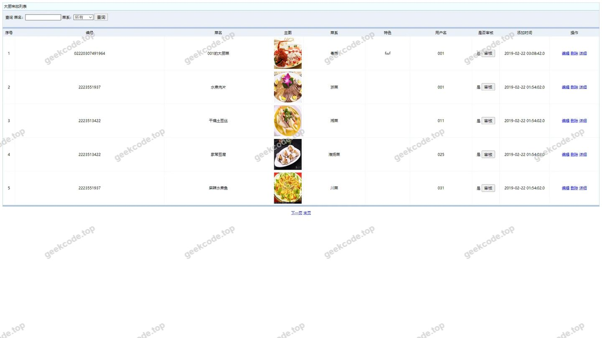</a>

<h4>页面-dcll列表</h4>

<a href="https://geekcode.top/archives/ssm%E9%95%BF%E8%AF%97%E5%9C%A3%E5%9C%B0%E7%BE%8E%E9%A3%9F%E4%BA%A4%E6%B5%81%E5%88%86%E4%BA%AB%E5%B9%B3%E5%8F%B0?utm_source=github" title="查看完整源码">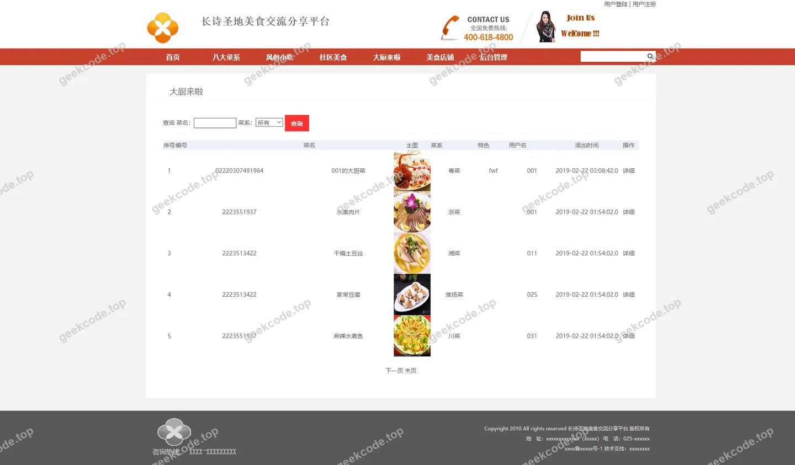</a>

<h4>页面-liuyanban列表</h4>

<a href="https://geekcode.top/archives/ssm%E9%95%BF%E8%AF%97%E5%9C%A3%E5%9C%B0%E7%BE%8E%E9%A3%9F%E4%BA%A4%E6%B5%81%E5%88%86%E4%BA%AB%E5%B9%B3%E5%8F%B0?utm_source=github" title="查看完整源码">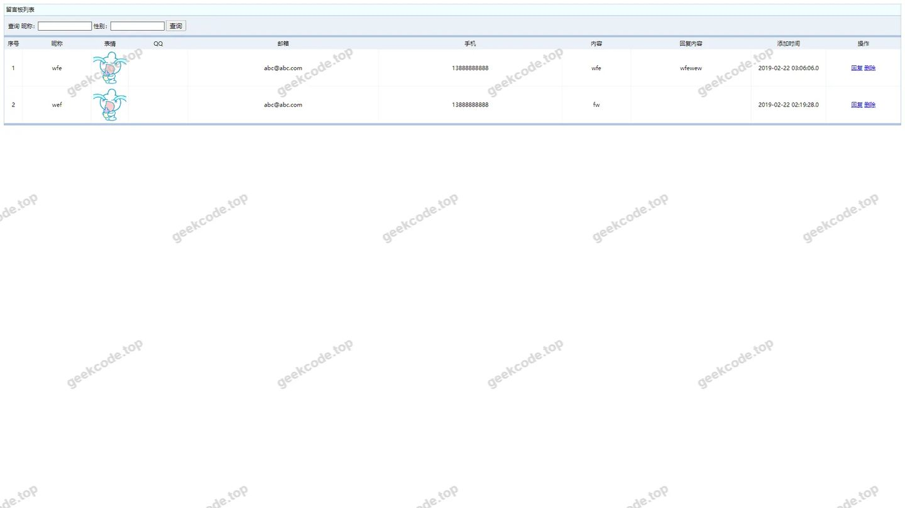</a>

<h4>页面-lyb列表</h4>

<a href="https://geekcode.top/archives/ssm%E9%95%BF%E8%AF%97%E5%9C%A3%E5%9C%B0%E7%BE%8E%E9%A3%9F%E4%BA%A4%E6%B5%81%E5%88%86%E4%BA%AB%E5%B9%B3%E5%8F%B0?utm_source=github" title="查看完整源码">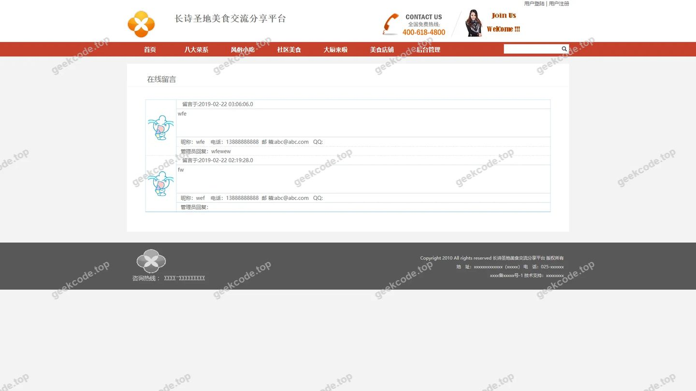</a>

<h4>页面-meishidianpu列表</h4>

<a href="https://geekcode.top/archives/ssm%E9%95%BF%E8%AF%97%E5%9C%A3%E5%9C%B0%E7%BE%8E%E9%A3%9F%E4%BA%A4%E6%B5%81%E5%88%86%E4%BA%AB%E5%B9%B3%E5%8F%B0?utm_source=github" title="查看完整源码">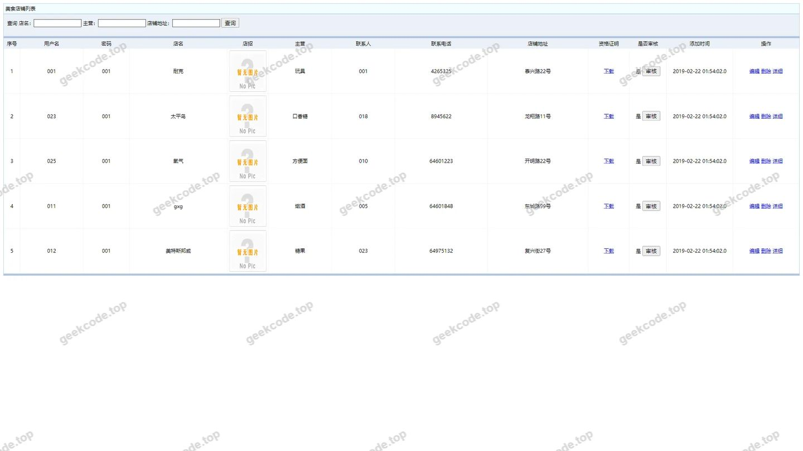</a>

<h4>页面-meishidianpulist</h4>

<a href="https://geekcode.top/archives/ssm%E9%95%BF%E8%AF%97%E5%9C%A3%E5%9C%B0%E7%BE%8E%E9%A3%9F%E4%BA%A4%E6%B5%81%E5%88%86%E4%BA%AB%E5%B9%B3%E5%8F%B0?utm_source=github" title="查看完整源码">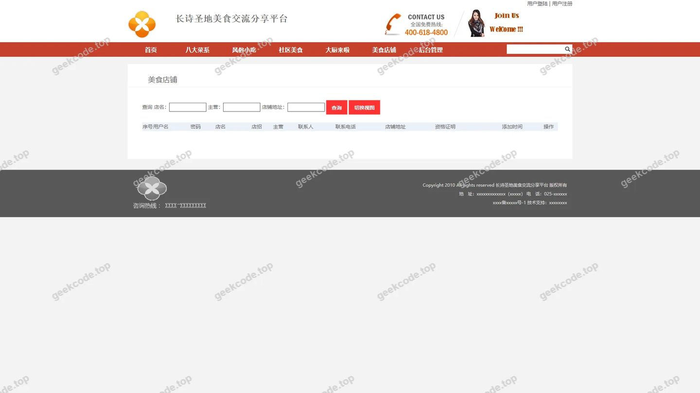</a>

<h4>页面-pinglun列表</h4>

<a href="https://geekcode.top/archives/ssm%E9%95%BF%E8%AF%97%E5%9C%A3%E5%9C%B0%E7%BE%8E%E9%A3%9F%E4%BA%A4%E6%B5%81%E5%88%86%E4%BA%AB%E5%B9%B3%E5%8F%B0?utm_source=github" title="查看完整源码">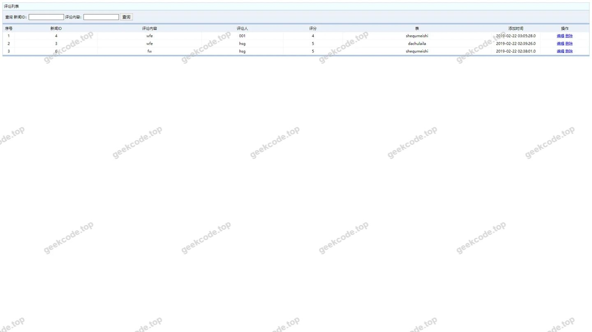</a>

<h4>页面-shequmeishi列表</h4>

<a href="https://geekcode.top/archives/ssm%E9%95%BF%E8%AF%97%E5%9C%A3%E5%9C%B0%E7%BE%8E%E9%A3%9F%E4%BA%A4%E6%B5%81%E5%88%86%E4%BA%AB%E5%B9%B3%E5%8F%B0?utm_source=github" title="查看完整源码">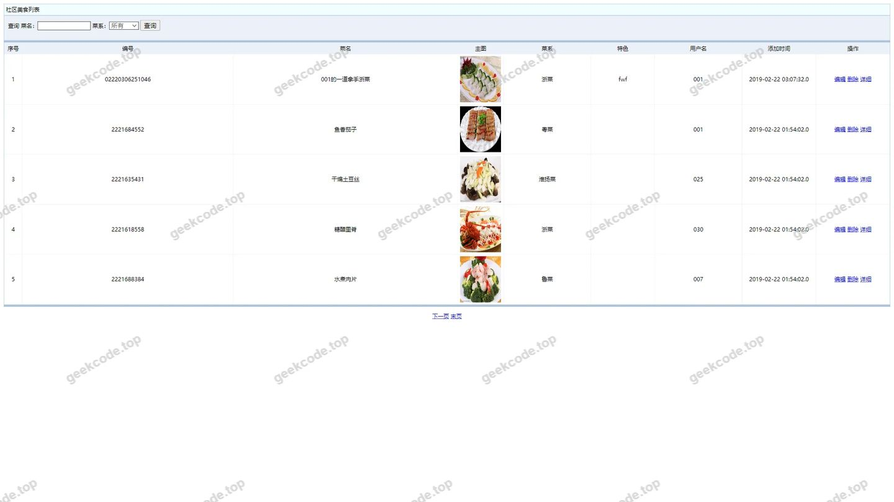</a>

<h4>页面-shequmeishilist</h4>

<a href="https://geekcode.top/archives/ssm%E9%95%BF%E8%AF%97%E5%9C%A3%E5%9C%B0%E7%BE%8E%E9%A3%9F%E4%BA%A4%E6%B5%81%E5%88%86%E4%BA%AB%E5%B9%B3%E5%8F%B0?utm_source=github" title="查看完整源码">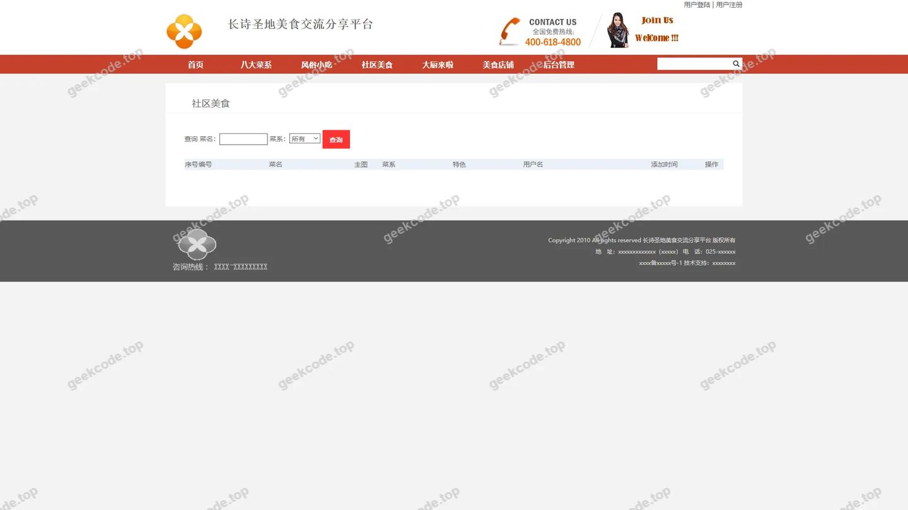</a>

<h4>页面-shoucangjilu列表</h4>

<a href="https://geekcode.top/archives/ssm%E9%95%BF%E8%AF%97%E5%9C%A3%E5%9C%B0%E7%BE%8E%E9%A3%9F%E4%BA%A4%E6%B5%81%E5%88%86%E4%BA%AB%E5%B9%B3%E5%8F%B0?utm_source=github" title="查看完整源码">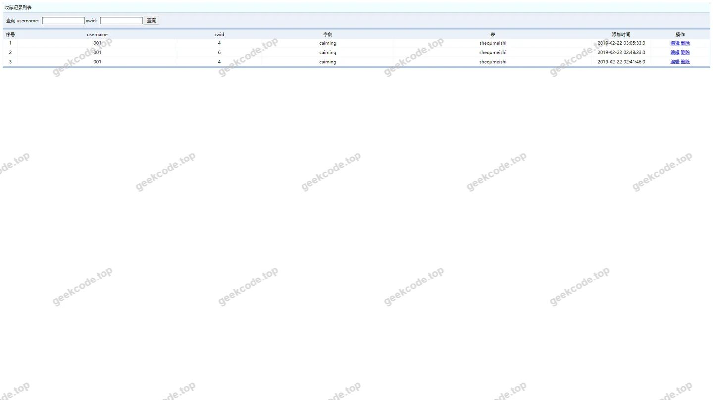</a>

<h4>页面-xinwentongzhi列表</h4>

<a href="https://geekcode.top/archives/ssm%E9%95%BF%E8%AF%97%E5%9C%A3%E5%9C%B0%E7%BE%8E%E9%A3%9F%E4%BA%A4%E6%B5%81%E5%88%86%E4%BA%AB%E5%B9%B3%E5%8F%B0?utm_source=github" title="查看完整源码">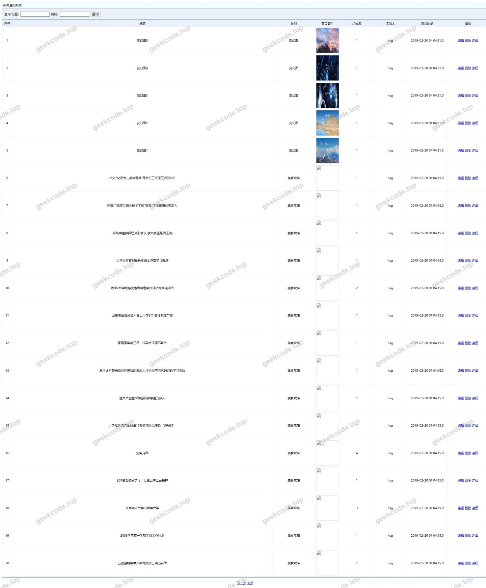</a>

<h4>页面-yonghuzhuce列表</h4>

<a href="https://geekcode.top/archives/ssm%E9%95%BF%E8%AF%97%E5%9C%A3%E5%9C%B0%E7%BE%8E%E9%A3%9F%E4%BA%A4%E6%B5%81%E5%88%86%E4%BA%AB%E5%B9%B3%E5%8F%B0?utm_source=github" title="查看完整源码">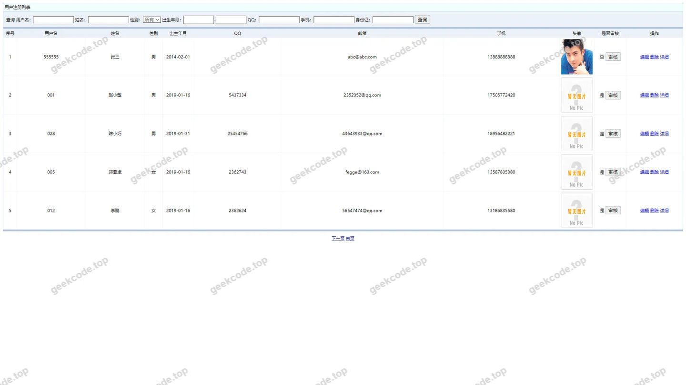</a>

<h4>页面-youqinglianjie列表</h4>

<a href="https://geekcode.top/archives/ssm%E9%95%BF%E8%AF%97%E5%9C%A3%E5%9C%B0%E7%BE%8E%E9%A3%9F%E4%BA%A4%E6%B5%81%E5%88%86%E4%BA%AB%E5%B9%B3%E5%8F%B0?utm_source=github" title="查看完整源码">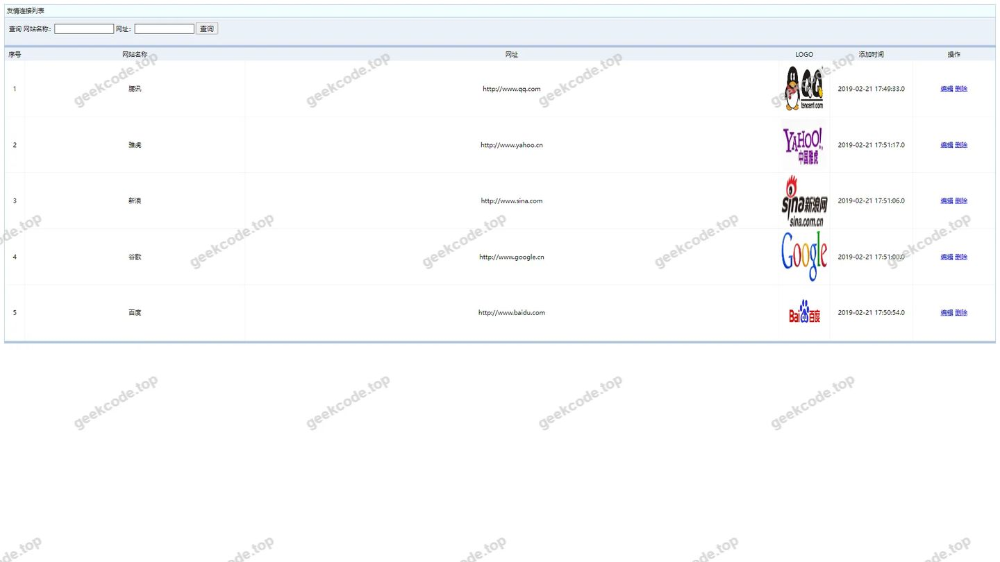</a>

<h4>页面-allusersupdt</h4>

<h4>页面-编辑</h4>

<h3>后台管理端</h3>
<h4>页面-allusers列表</h4>

<a href="https://geekcode.top/archives/ssm%E9%95%BF%E8%AF%97%E5%9C%A3%E5%9C%B0%E7%BE%8E%E9%A3%9F%E4%BA%A4%E6%B5%81%E5%88%86%E4%BA%AB%E5%B9%B3%E5%8F%B0?utm_source=github" title="查看完整源码">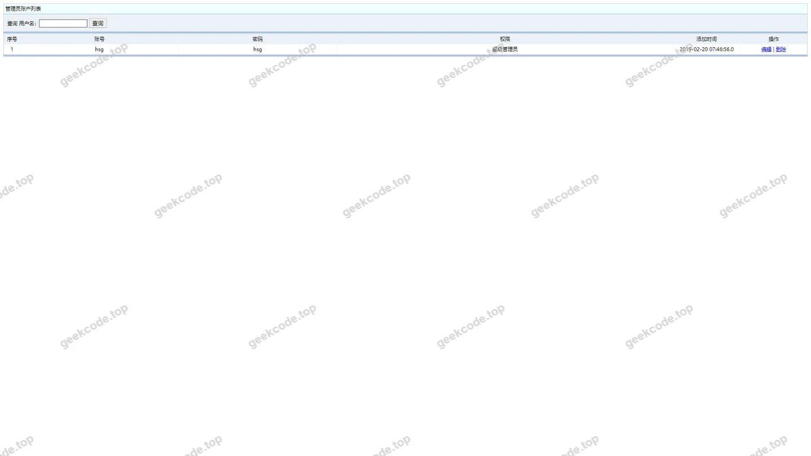</a>

---

## 获取完整源码

| 项目 | 说明 |
| --- | --- |
| 项目名 | ssm长诗圣地美食交流分享平台 |
| 运行截图 | 本文 17 张（站点带水印原图，仓库 `images/` 目录） |
| 完整源码 | [https://geekcode.top/archives/ssm%E9%95%BF%E8%AF%97%E5%9C%A3%E5%9C%B0%E7%BE%8E%E9%A3%9F%E4%BA%A4%E6%B5%81%E5%88%86%E4%BA%AB%E5%B9%B3%E5%8F%B0?utm_source=github](https://geekcode.top/archives/ssm%E9%95%BF%E8%AF%97%E5%9C%A3%E5%9C%B0%E7%BE%8E%E9%A3%9F%E4%BA%A4%E6%B5%81%E5%88%86%E4%BA%AB%E5%B9%B3%E5%8F%B0?utm_source=github) |
| 咨询微信 | **ir9372**（备注：jingpin-yuanma） |
| 更多项目 | [极客代码 geekcode.top](https://geekcode.top/?utm_source=github) |

> 需要源码、部署、改配置、跑不起来等问题，加微信 ir9372 沟通，说明项目名即可。
